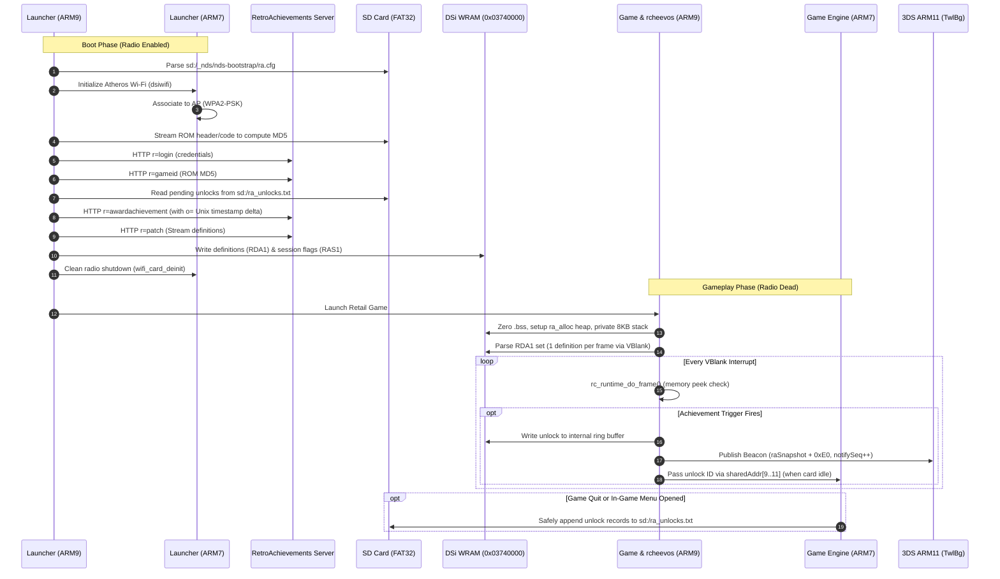

# AGENTS.md — Developer & Agent Guide for RA3DS (RetroAchievements DS on 3DS)

Welcome to **RA3DS** (`nds-bootstrap-ra`), a project bringing native [RetroAchievements](https://retroachievements.org) support to the Nintendo 3DS family (with focus on the New Nintendo 3DS) playing Nintendo DS games natively.

This document serves as the single source of architectural truth, hardware realities, memory constraints, debugging methodologies, and development roadmap for autonomous agents and human developers.

---

## 1. Project Mission & Core Architecture

### 1.1 What This Is (and Is Not)
* **Real Hardware, Not an Emulator:** [nds-bootstrap](file:///C:/Users/kike/dev/RA3DS/README.md) is Nintendo DS ROM loader middleware, not an emulator. It loads clean DS/DSi ROMs from an SD card and executes them directly on the console's physical ARM9 and ARM7 CPUs.
* **Code Injection via Cardengine:** Game execution is patched to redirect Slot-1 cartridge reads to an SD card engine injected directly into the running game's memory space. Reading game RAM is done via raw CPU pointer dereferencing with zero emulation overhead.
* **Platform Scope:** The RetroAchievements functionality targets the **Nintendo 3DS family** (Old 3DS, 2DS, New 3DS, New 2DS XL). While running in TWL (DSi) mode, the hardware environment includes the legacy DS processors plus the 3DS ARM11 infrastructure running [`TwlBg`](file:///C:/Users/kike/dev/RA3DS/docs/twlbg-overlay-proposal.md).

### 1.2 Modular Decomposition
The project enforces strict separation of concerns across multiple execution contexts:

| Module / Component | Target CPU / Region | Source Files | Responsibilities |
|---|---|---|---|
| **`ra_wifi` (Launcher Ladder)** | DS ARM9 & ARM7 (Launcher) | [`retail/arm9/source/ra_wifi.c`](file:///C:/Users/kike/dev/RA3DS/retail/arm9/source/ra_wifi.c), [`retail/arm7/source/ra_wifi7.c`](file:///C:/Users/kike/dev/RA3DS/retail/arm7/source/ra_wifi7.c) | 15-stage hardware bring-up ladder: Atheros radio init via `dsiwifi`, WPA2 handshake, DHCP/DNS, HTTP connection, clean radio deinit before game launch. |
| **`ra_net` & `ra_hash`** | DS ARM9 (Launcher) | [`retail/arm9/source/ra_net.c`](file:///C:/Users/kike/dev/RA3DS/retail/arm9/source/ra_net.c), [`retail/arm9/source/ra_hash.c`](file:///C:/Users/kike/dev/RA3DS/retail/arm9/source/ra_hash.c) | Low-memory ROM MD5 generation matching `rc_hash_nintendo_ds()`; plain HTTP client talking to `dorequest.php` (`r=login`, `r=gameid`). |
| **`ra_patch`** | DS ARM9 (Launcher) | [`retail/arm9/source/ra_patch.c`](file:///C:/Users/kike/dev/RA3DS/retail/arm9/source/ra_patch.c) | Zero-heap streaming scanner for `r=patch` JSON (>100KB socket data parsed directly into 32KB staging block). |
| **`ra_queue`** | DS ARM9 (Launcher) | [`retail/arm9/source/ra_queue.c`](file:///C:/Users/kike/dev/RA3DS/retail/arm9/source/ra_queue.c) | Manages offline unlock records, HMAC/MD5 token generation, Unix timestamp calculations (`o=` parameter), queue draining. |
| **`cardenginei_arm9_ra`** | DS ARM9 (DSi WRAM `0x03740000`) | [`retail/cardenginei/arm9_ra/`](file:///C:/Users/kike/dev/RA3DS/retail/cardenginei/arm9_ra/) | 256KB standalone ARM9 payload. Runs custom memory allocator [`ra_alloc.c`](file:///C:/Users/kike/dev/RA3DS/retail/cardenginei/arm9_ra/source/ra_alloc.c), private 8KB stack, official `rcheevos` runtime ([`rc_runtime.c`](file:///C:/Users/kike/dev/RA3DS/retail/cardenginei/arm9_ra/rcheevos/src/rcheevos/rc_runtime.c)), and unlocks ring. |
| **`ra_reader`** | DS ARM9 (Cardengine) | [`retail/cardenginei/arm9/source/ra_reader.c`](file:///C:/Users/kike/dev/RA3DS/retail/cardenginei/arm9/source/ra_reader.c) | Per-frame VBlank hook bridge, pointer chain validation, memory peek boundary check, and `raSnapshot` telemetry provider. |
| **`ra_overlay`** | DS ARM9 (DSi WRAM & Cardengine) | [`retail/cardenginei/arm9_ra/source/ra_overlay.c`](file:///C:/Users/kike/dev/RA3DS/retail/cardenginei/arm9_ra/source/ra_overlay.c) | DS-side notification rendering (sprite OAM scanning with fallback to borrowed BG layer). |
| **`ra_beacon` (3DS ARM11 Bridge)** | DS ARM9 -> 3DS ARM11 (`TwlBg`) | [`retail/common/include/ra.h`](file:///C:/Users/kike/dev/RA3DS/retail/common/include/ra.h#L989-L995), [`docs/twlbg-overlay-proposal.md`](file:///C:/Users/kike/dev/RA3DS/docs/twlbg-overlay-proposal.md) | Asynchronous lockless sequence counter + unlock payload published in DS RAM (`raSnapshot + 0xE0`) for native ARM11 framebuffer compositing. |
| **In-Game Menu (IGM)** | DS ARM9 (Injected overlay) | [`retail/cardenginei/arm9_igm/source/inGameMenu.c`](file:///C:/Users/kike/dev/RA3DS/retail/cardenginei/arm9_igm/source/inGameMenu.c) | Displays achievements status, sync pending tallies, and locks the RAM editor when `hardcore=1`. |

---

## 2. Key Repositories & Lineage

1. **Fork Base:** [`Bakkerrrs/Retroachievements-DS-on-3DS`](https://github.com/Bakkerrrs/Retroachievements-DS-on-3DS)
   - Branches from upstream `DS-Homebrew/nds-bootstrap` at commit [`6f3d23f`](file:///C:/Users/kike/dev/RA3DS) (2026-07-31).
   - Milestone commit `fa141d1`: First working end-to-end RetroAchievements integration.
   - Latest milestone `4d60695`: Confirmed LGYFB hardware path and 3DS ARM11 video compositing feasibility.
2. **Upstream Loader:** [`DS-Homebrew/nds-bootstrap`](https://github.com/DS-Homebrew/nds-bootstrap)
   - Responsible for game patching, DLDI, FAT32/SD driver, save redirection, sleep mode, and ARM7/ARM9 synchronization.
3. **Official RetroAchievements Libraries:** [`RetroAchievements/rcheevos`](https://github.com/RetroAchievements/rcheevos)
   - Pinned submodule at [`v12.4.0`](file:///C:/Users/kike/dev/RA3DS/retail/cardenginei/arm9_ra/rcheevos) (`2ad0b86`).
   - Evaluates condition logic, delta values, hit counts, pauses, resets, and triggers.

---

## 3. Detailed Runtime Workflow



---

## 4. Hardware Realities & Hard Constraints

### 4.1 Memory Allocation & Locations
DSi mode grants access to extended RAM and DSi Work RAM (WRAM).
* **ARM9 Cardengine Window (`retail/cardenginei/arm9`):** Extremely constrained. At times only **24 to 60 bytes free**. Never place strings, buffers, or heavy logic here.
* **DSi WRAM (`0x03740000`, 256KB):** Mapped to ARM9. Managed by [`retail/cardenginei/arm9_ra`](file:///C:/Users/kike/dev/RA3DS/retail/cardenginei/arm9_ra/):
  - `0x03740000`: Code, rodata, data of `cardenginei_arm9_ra`.
  - `.bss` end to `0x03777FFF`: Arena managed by [`ra_alloc.c`](file:///C:/Users/kike/dev/RA3DS/retail/cardenginei/arm9_ra/source/ra_alloc.c) (approx 140KB–158KB for `rcheevos` triggers/memrefs).
  - `0x03778000` (`CARDENGINEI_ARM9_RA_DEFS_LOCATION`): 32KB buffer holding staged definitions (`RDA1`).
  - `0x0377F600` (`CARDENGINEI_ARM9_RA_VIEWER_LOCATION`): 2.5KB viewer index (`RAV1`).
  - `0x0377FFE0` (`CARDENGINEI_ARM9_RA_SESSION_LOCATION`): 256-byte session configuration block (`RAS1`).
  - `0x0377FE00` (`CARDENGINEI_ARM9_RA_PENDING_LOCATION`): 512-byte sync pending tally (`RAP1`).
* **Game IRQ Stack vs Private Stack:**
  - Running `rcheevos` on the game's IRQ stack caused silent stack overflows and random Data Aborts.
  - `rc_runtime_activate_achievement()` requires up to **2,383 bytes**.
  - `rc_runtime_do_frame()` requires **767 bytes**.
  - `cardenginei_arm9_ra` provides an **independent 8KB stack**; all `rcheevos` operations run on this dedicated stack.

### 4.2 In-Game Networking: Closed by Hardware Measurement
* **The Problem:** During gameplay, retail games replace the launcher's ARM7 binary and reset hardware (I2C power management, SDIO controller reset).
* **Measured Result:** The Wi-Fi AP association drops within seconds of game launch. Holding the association in-game would require resident `dsiwifi` (104KB) inside ARM7 IWRAM (where only 12KB is free).
* **The Architectural Rule:** **Zero networking during gameplay.** All unlocks earned offline are queued to [`sd:/ra_unlocks.txt`](file:///C:/Users/kike/dev/RA3DS/tools/ra.example.cfg) and submitted on subsequent boots with `o=` (seconds elapsed since earn time).

### 4.3 Safe SD Card Writing & SDIO Contention
* The SD card is shared between game ROM streaming and nds-bootstrap.
* An interrupt-driven file write while a non-blocking card read was pending (`readOngoing`) corrupted SD buffers and froze games (e.g., *Ketsui Death Label* boss kill freeze).
* **Solution:** Unlocks are held in memory during active gameplay and only drained/flushed to SD when the game is cleanly exited or when the In-Game Menu is opened.

---

## 5. The 3DS & New 3DS Advantage: TwlBg Overlay

### 5.1 Why DS-Side Overlays Fail
On Nintendo DS hardware, displaying a notification requires borrowing the running game's resources:
1. Re-pointing background character blocks (can corrupt game tiles).
2. Forcing priority on BG layers (fails when the game enables higher priority layers or windows).
3. Finding free sprite/OAM slots (can delete game sprites/bullets).
4. Stealing palette entries (games running in 8bpp mode share the entire 256-color palette, corrupting graphics).
5. On complex games (e.g. *Ketsui*), all 9 VRAM banks are actively locked by the engine—there is **nowhere safe on DS hardware to draw**.

### 5.2 The 3DS Video Pipeline & LGYFB
When a 3DS plays DS games, the **3DS ARM11 CPU** remains active running `TwlBg`:
```
NDS Video Controller
   │
   ▼
LgyFB Hardware Block (Upscales 256x192 -> 320x240)
   │
   ▼
LGYFB_FIFO (0x10310000 Bottom / 0x10311000 Top)
   │
   ▼
CDMA (Channels 0Dh / 0Eh)
   │
   ▼
Framebuffer in 3DS Memory (RGBA8888, RGB8880, RGB5551, RGB5650)
   │
   ▼
PICA200 GPU -> 3DS LCD Screens
```

### 5.3 The Unlock Beacon Protocol (`RA2S`)
Instead of risky DS VRAM manipulation, the DS ARM9 writes an unlock beacon into DS RAM at offset `+0xE0` of [`raSnapshot`](file:///C:/Users/kike/dev/RA3DS/retail/common/include/ra.h#L989):

```c
+0x00  char[4]   magic;          // "RA2S" (0x53324152)
+0xE0  u32       notifySeq;      // Incremented per unlock (lockless sequence counter)
+0xE4  u32       notifyId;       // RetroAchievements achievement ID (e.g., 301278)
+0xE8  u8        notifyHardcore; // 1 = Hardcore, 0 = Softcore
+0xE9  u8        notifyLen;      // Byte length of title
+0xEA  u16       notifyPad;
+0xEC  char[64]  notifyTitle;    // Achievement title (UTF-8, NUL-padded)
```
* **Synchronization:** `notifyTitle`, `notifyId`, and mode are written first, followed by cache flush and write-buffer drain (`CP15 c7`). `notifySeq` is updated last. The ARM11 polls `notifySeq` without handshakes.
* **New 3DS Opportunity:** New 3DS features 4 ARM11 cores @ 804MHz and 256MB FCRAM (vs. 2 cores @ 268MHz and 128MB on Old 3DS). Custom `TwlBg.cxi` builds (or sysmodules) on New 3DS have immense headroom to composite high-resolution fonts, badge icons, and animations over the LCD output without affecting game timing.

---

## 6. Snapshot Inspection & Debugging Guide

When debugging on real hardware or emulators with memory dumpers, inspect `raSnapshot` using the In-Game Menu RAM Viewer. Locate the ASCII signature `RA2S`:

| Offset | Field | Normal Value | Diagnostic Meaning |
|---|---|---|---|
| `+0x00` | `magic` | `'R','A','2','S'` | Snapshot signature. `RA1S`/`RA0S` indicates stale layout. |
| `+0x04` | `ticks` | Climbing continuously | VBlank interrupt hook is alive and executing. |
| `+0x60` | `heapSize` | ~150,000 | Total arena bytes available to `ra_alloc`. |
| `+0x64` | `heapUsed` | ~110,000–130,000 | Bytes consumed by `rcheevos` definitions. |
| `+0x68` | `wramStage` | `4` (`RA_STAGE_WATCHES`) | 1=BSS zeroed, 2=Heap ready, 3=Alloc ok, 4=Running. |
| `+0x6A` | `rcStackUsed`| ~2,383 max | High-water mark of the private 8KB rcheevos stack. |
| `+0x6C` | `rcStage` | `7` (`RA_RC_FRAME`) | 5=Loading/parsing, 6=Active, 7=Frame evaluated. |
| `+0x6D` | `rcActivate` | `0` (`RC_OK`) | Error code from definition activation if non-zero. |
| `+0x70` | `rcTriggered`| Incrementing | Number of achievement unlocks delivered this session. |
| `+0x80` | `rcPeeksRejected`| `0` | If > 0, an achievement tried reading unmapped/invalid memory. |
| `+0x85` | `rcLinesMax` | < 70 (of 263) | Peak scanlines consumed by evaluation in a frame. |
| `+0x98` | `rcFromFile` | `1` | 1 = Server-staged set loaded; 0 = Fallback built-in test. |
| `+0x99` | `rcActivated`| Total count (e.g. 56) | Number of definitions successfully activated. |
| `+0x9C` | `rcBadLine` | `0` | If non-zero, the line number of a syntax/parser error. |
| `+0xA0` | `rcFirstId` | Valid RA ID | ID of the first achievement to trigger. |
| `+0xC4` | `defsMagic` | `'R','D','A','1'` | Verifies that bootloader copied staged definitions cleanly. |
| `+0xE0` | `notifySeq` | Increments on unlock | Beacon counter for external ARM11 display. |

---

## 7. Build System & Toolchain Specification

### 7.1 Pinned Toolchain Requirement
> [!IMPORTANT]
> This codebase **strictly requires libnds 1.8.0** (devkitARM r65, pinned in Docker image `devkitpro/devkitarm:20241104`).
> Newer libnds 2.x removed `nds/fifocommon.h`, `nds/fifomessages.h`, `nds/arm7/clock.h`, and `sec_t`. Building with libnds 2.x will fail.

### 7.2 Host Tool: `lzss`
All `.lz77` targets require the `lzss` host binary:
* Windows: [`lzss.exe`](file:///C:/Users/kike/dev/RA3DS/lzss.c) in the repo root or on `PATH`.
* Linux / macOS: `gcc lzss.c -o /usr/local/bin/lzss`.

### 7.3 Build Modes & Flags
* `make RA_LAUNCHER_WIFI=0`: Clean build without Wi-Fi ladder (offline testing).
* `make RA_LAUNCHER_WIFI=1`: Diagnostic mode. Runs 15-rung ladder, displays diagnostic summary on screen, writes [`ra_wifi_launcher.log`](file:///C:/Users/kike/dev/RA3DS/docs/logs/), does not boot game.
* `make RA_LAUNCHER_WIFI=2`: **Production deliverable mode.** Runs ladder, downloads achievements, stages them in WRAM, deinitializes radio, and boots game.
* **Build Serially:** Always build with single-threaded `make` (do not use `-j`, which causes link race conditions on intermediate archives).

### 7.4 Deliverable Packaging Script
Never manually copy `retail/bin/nds-bootstrap.nds`. Always use:
```bash
tools/ra_release.sh
```
This script cleans the tree, verifies `RA_LAUNCHER_WIFI=0` compiles, builds `RA_LAUNCHER_WIFI=2`, checks symbol tables for `dsiwifi` presence, verifies the IGM text structure alignment, executes the 1,020+ check host test suite, and outputs [`nds-bootstrap-release.nds`](file:///C:/Users/kike/dev/RA3DS/RELEASE-v0.1.0.md).

### 7.5 Host Test Suite (Fast Verification)
Run before every commit without hardware or devkitARM:
```bash
tools/ra_reader_test.sh
```
Builds and runs 3 native host binaries:
1. `ra_reader_test`: Validates pointer chain resolution, address bounds, and memory translation.
2. `ra_launcher_test`: Validates ROM MD5 calculation, URL percent encoding, JSON string parsing, and unlock queue signatures.
3. `ra_fit_test`: Validates full 56-definition sets against the simulated DSi WRAM arena.

---

## 8. Configuration File Specification (`ra.cfg`)

Placed on SD card at `sd:/_nds/nds-bootstrap/ra.cfg`:

```ini
# Credentials (sent in cleartext over HTTP to dorequest.php)
username=YourUsername
password=YourPassword

# Modes
hardcore=0               # 1 = Lock RAM editor, refuse cheats (submits to RA server in Hardcore mode)
user_agent=              # Custom HTTP User-Agent. Defaults to:
                         # RetroArch/1.19.1 (Nintendo 3DS) melonDS DS/1.0.0 rcheevos/12.4.0
                         # Set to nds-bootstrap-ra/0.1 for raw development testing.
overlay=1                # 0 = Off, 1 = Opt-in via overlay_games, 2 = Always
overlay_games=14856      # Comma-separated RetroAchievements GameIDs
queue=1                  # 1 = Safe unlock queueing, 0 = Disabled, 3 = Handoff diagnostic
sync=1                   # 1 = Run Wi-Fi boot ladder, 0 = Skip and play from cache
submit=1                 # 1 = Send queued unlocks to server, 0 = Hold in queue (testing)
verbose_log=0            # 1 = Full screen diagnostic during boot
debug=0                  # Extra logging
```

---

## 9. Upstream Alignment & Sync Strategy

The fork's base is commit [`6f3d23f`](file:///C:/Users/kike/dev/RA3DS) (2026-07-31). Upstream has progressed with commits touching:
* `retail/common/include/locations.h` (notably upstream commit `eb15863` which centralized card engine size constants).
* `retail/bootloaderi/` and `retail/cardenginei/` link scripts (`cardengine.ld.in`).
* In-Game Menu (`inGameMenu.c`).
* Anti-piracy fixes and homebrew DLDI patching.

When merging upstream updates:
1. Protect `locations.h` DSi WRAM reservations (`0x03740000`–`0x0377FFFF`).
2. Maintain `CARDENGINEI_ARM9_SIZE` limits; ensure cardengine additions do not exceed the linker window.
3. Check `struct IgmText` size synchronization with `.space` in [`arm9_igm/source/card_engine_header.s`](file:///C:/Users/kike/dev/RA3DS/retail/cardenginei/arm9_igm/source/card_engine_header.s).
4. Abide by upstream `AI-GUIDELINES.md` (human verification, disclosure, no mass AI code dumps).

---

## 10. Active Development Priorities & Roadmap

1. **RetroAchievements Client Registration & Hardcore Status:**
   - **Hardcore Feasibility Confirmed:** Live tests against `retroachievements.org` using account `RA3DS` proved that the server accepts hardcore submissions (`h=1`) and offline delta timestamps (`o=...`) when using an accepted User-Agent (`RetroArch/` >= 1.19.0). Unlocks award full Hardcore points without downgrade.
   - **Option 1 Implemented:** Configurable `user_agent=` added to `ra.cfg` (defaulting to `RetroArch/1.19.1 (Nintendo 3DS) melonDS DS/1.0.0 rcheevos/12.4.0` with `RA_NET_CLIENT_VERSION = "12.4.0"`).
   - Official registration dialog for native `nds-bootstrap-ra` client ID tracked in [`docs/ra-registration-request.md`](file:///C:/Users/kike/dev/RA3DS/docs/ra-registration-request.md).
2. **Native 3DS ARM11 TwlBg Overlay:**
   - Implement the companion reader in custom `TwlBg.cxi` to consume the `RA2S` beacon at `raSnapshot + 0xE0`.
   - Direct RGB framebuffer rendering via CDMA/LgyFB on 3DS ARM11, eliminating DS VRAM borrowing entirely.
3. **Queue Drainage Robustness & Exact VBlank Timestamps (Implemented):**
   - **Discrepancy Resolved:** Replaced single-timestamp session compromise with exact per-achievement VBlank frame timers (`snapshot->ticks / 60`) on ARM9, passed via IPC slot 12 (`RA_SHARED_UNLOCK_TIME`) to ARM7.
   - **64-Byte Queue Records:** Expanded `RA_QUEUE_RECORD` from 48 to 64 bytes (`<id>\t<YYYYMMDDhhmmss>\t<code>\t<title>\t<h>\t<elapsed_s>\n`), providing clean 8-record alignment per 512-byte SD sector.
   - **Down-to-the-Second Spacing:** `raQueueScan()` on next boot computes $T_{\text{earned}} = T_{\text{start}} + \text{elapsed\_s}$, generating distinct and realistic offsets $o = T_{\text{now}} - T_{\text{earned}}$ for every unlock, fully protecting against anti-cheat batch/instant unlock flags.
4. **Upstream Rebase:**
   - Cleanly rebase against latest upstream `master` while respecting centralized card engine size constants.
